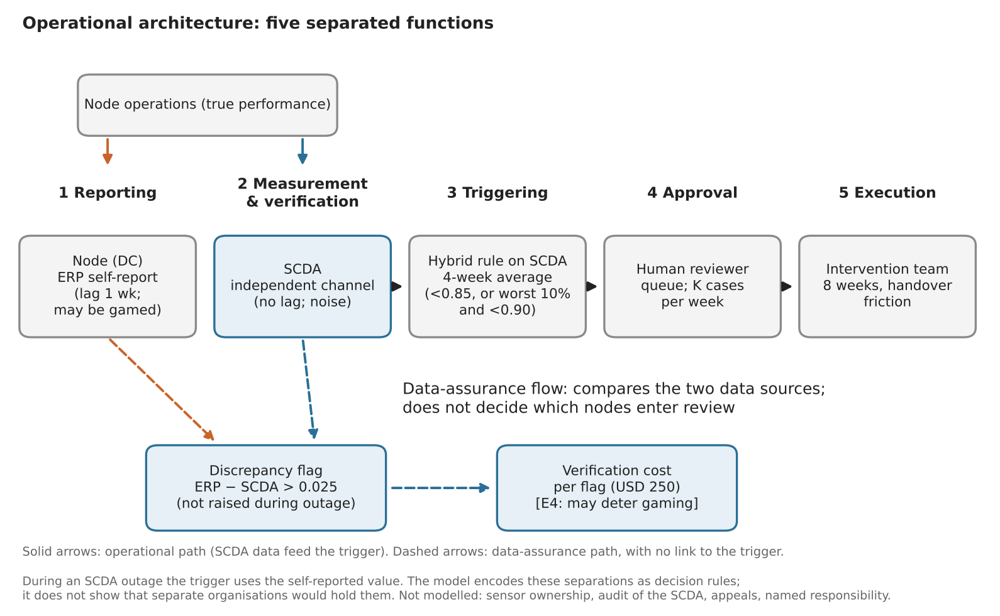
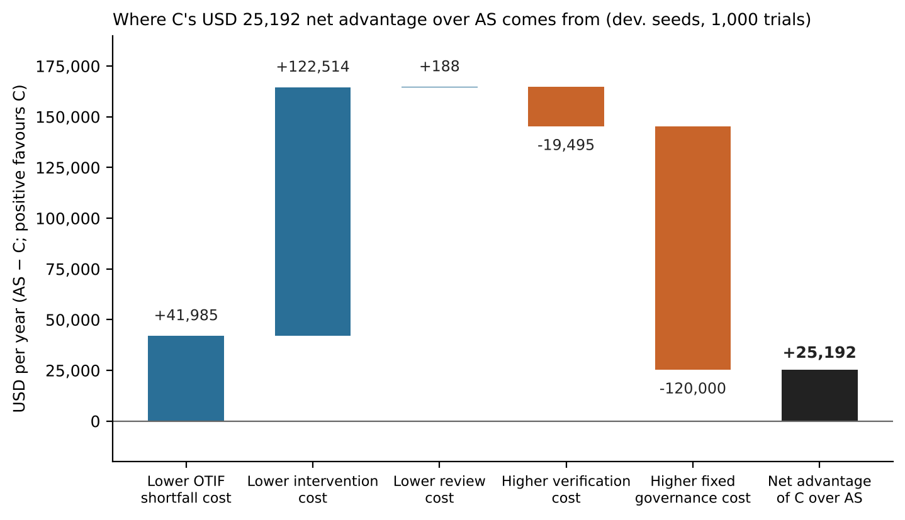

# Evaluating the Operational Feasibility of an Institutional Governance Architecture for Multi-Node Distribution Networks: Independent Data Assurance, Threshold-Based Safety Fuses, and Human-Accountable Exception Management

**Quoc Thinh Vo**\
Independent Researcher\
Thinhvo1106@gmail.com

*Working Paper — [date of posting]*

---

## Abstract

Multi-node distribution networks must detect failing nodes quickly, trust the data they act on, and avoid unnecessary intervention. This paper evaluates by simulation a governance architecture adapted from a stylized institutional framework (Vo, 2026): independent supply chain data assurance, a predefined safety fuse, and capacity-limited human review of exceptions. A paired Monte Carlo model of 30 distribution centres over 52 weeks compares it with conventional management and control variants. Under synthetic assumptions, the architecture lowers annual cost by about USD 0.85 million against monthly discretionary management, but only about USD 25,000 (0.4%) against a strong weekly baseline. The advantage reverses when conventional data are timely, when verifying a flag costs more than about USD 570, when independent measurement is noisy or often unavailable, or when review capacity is one case a week; when interventions are weak, no governance design beats doing nothing. Timeliness appears to explain most of the advantage; independence as such was not shown to matter economically. Main contrasts replicate on independent seeds. Inputs are synthetic and single-tier, so the results are a feasibility map, not an empirical estimate.

**Keywords:** supply chain governance; operational resilience; data integrity; algorithmic oversight; safety fuse; Goodhart's law; simulation; feasibility assessment

---

## 1. Introduction

Global logistics networks run on information that the managed units themselves produce. Distribution centres, carriers and third-party logistics providers report on-time-in-full (OTIF) performance, shipping documents and exception status, and the organisation then rewards, penalises or replaces them on that basis. Two long-standing problems follow. The first is distortion: information degrades as it moves between tiers (Lee, Padmanabhan, & Whang, 1997), and when an indicator becomes a target, reporting adapts to the target rather than to the underlying condition (Power, 1997; Bevan & Hood, 2006; Muller, 2018). The second is delayed and misdirected correction: disruptions impose lasting damage on firm performance (Hendricks & Singhal, 2005), yet intervention in a failing node is often late because the signal is weak, contested or politically inconvenient, while mechanical rules that intervene automatically can disrupt units that were performing adequately.

Practitioners have responded with visibility platforms, control towers and scorecards. These improve the availability of operational data, but the literature increasingly stresses that visibility, traceability and transparency are distinct capabilities with different data requirements (Nie, Tsolakis, Dora, & Kumar, 2026), and that information does not improve outcomes unless an actor with the capacity and incentive to act on it is attached to it (Fung, Graham, & Weil, 2007; Kosack & Fung, 2014). The growing use of algorithmic screening of shipping documents and vendor performance adds a further question: where the algorithm flags and a person decides, does the person actually exercise judgement, or defer to the machine (Parasuraman & Manzey, 2010; Citron, 2008)? Governance frameworks for AI risk emphasise accountability and human oversight but are deliberately non-prescriptive about institutional structure (Tabassi, 2023).

This paper asks whether a specific institutional configuration can address these problems at acceptable cost. The configuration is adapted from a stylized framework in political institutional design (Vo, 2026), in which independent evidence custody, pre-committed automatic escalation, and human-signed enforcement are combined. We translate three of its mechanisms into a logistics setting:

1. **Independent supply chain data assurance (SCDA):** an audit function that measures node performance directly from carrier, terminal and warehouse event feeds and compares it with node self-reports. It has no operational or purchasing authority.
2. **A threshold-based operational safety fuse:** a pre-defined rule that triggers a proposal for human-reviewed intervention by a central rapid-response team when a node breaches an absolute performance floor, or is both in the bottom decile and below a relative cap.
3. **Human-accountable exception management:** automated detection proposes, and a named reviewer with finite capacity approves, an intervention.

We treat feasibility as a conditional and testable proposition, and the contribution is deliberately modest: (i) a simulation design in which competing governance variants face identical shocks, so differences are attributable to governance and not to luck; (ii) a partial disentanglement, by control variants, of the contributions of data timeliness, trigger design and review procedures; (iii) break-even and robustness analysis that states the conditions under which the architecture is not worth implementing; and (iv) directions for validating the model on real operational data (§8.5).

**Research questions.** Can the architecture improve operational resilience, data integrity and decision accountability without excessive cost, delay or complexity? We examine four hypotheses, stated as directions to test, not as findings:

- **H1 (data integrity).** Independent measurement reduces the gap between the performance an organisation sees and true performance, and raises the probability that distorted reports are detected.
- **H2 (resilience).** A predefined threshold fuse shortens disruption duration relative to discretionary management.
- **H3 (economic feasibility).** Avoided losses exceed governance costs, but only under identifiable conditions.
- **H4 (governance trade-off).** Added oversight layers improve accountability but add latency and coordination cost, and can fail under load. Accountability itself is not measured in this paper; the results speak only to intervention targeting, review load and failure under load.

**What this paper does not claim.** All numerical inputs are synthetic assumptions; none is estimated from a real network. The simulation indicates what the mechanisms do under stated assumptions, and where conclusions reverse, but it does not show that any real firm would obtain these savings. The institutional framework from which the mechanisms are adapted is itself a stylized design that has not been implemented (Vo, 2026), and the transfer of political-institutional mechanisms to firms is by analogy, not by evidence.

The paper proceeds as follows. Section 2 reviews related work and the gap. Section 3 describes the architecture. Section 4 sets out the feasibility methodology, Section 5 the simulation design, Section 6 results and robustness, Section 7 the relation of the architecture to existing approaches, and Section 8 discussion, limitations and conclusions.

---

## 2. Literature Review and Research Gap

### 2.1 Information distortion and visibility

The bullwhip literature established that order information is distorted as it travels upstream, with demand signal processing, order batching, price variation and rationing games as sources (Lee et al., 1997). Subsequent work on visibility, traceability and transparency distinguishes their data needs: real-time operational data for visibility, historical product-level data for traceability, and contextual disclosure data for transparency (Nie et al., 2026). Our concern is a different distortion from demand amplification: the strategic or incidental distortion of *performance reports* by the units being measured. This links to the broader accountability literature, where disclosure is shown to improve outcomes only when the recipient can use it and the data cannot be gamed by the monitored party (Fung et al., 2007; Kosack & Fung, 2014).

### 2.2 Resilience and disruption response

Supply chain disruptions have measurable and persistent performance costs (Hendricks & Singhal, 2005), and resilience is variously defined as the ability to return to, or move to a better, state after disturbance (Christopher & Peck, 2004). Resilience can be built by redundancy, which is pure cost absent a disruption, or by flexibility, which also yields day-to-day benefits (Sheffi & Rice, 2005). Kleindorfer and Saad (2005) frame disruption management as joint risk assessment and mitigation. At network level, the ripple effect and viability of intertwined supply networks extend the unit of analysis beyond a single chain (Ivanov & Dolgui, 2020). This literature largely addresses *what* to do after detection; it says less about *who decides* to intervene in an underperforming node, on what evidence, and with what check against false intervention. That decision-rights question is where institutional design is relevant.

### 2.3 Measurement targets, gaming and relative ranking

Audit and performance-measurement regimes can shape the behaviour they measure, producing compliance with indicators in place of improvement (Power, 1997; Bevan & Hood, 2006; Muller, 2018). Two implications bear on fuse design. First, a trigger based on relative rank guarantees that some unit is always at the bottom, even when all units perform well, and rewards displacement or concealment near the threshold. Second, a trigger fed by self-reported data inherits whatever distortion the reporters introduce. Our hybrid trigger and the independent data assurance function are direct responses, and we test both separately.

### 2.4 Algorithmic flagging and human oversight

Requiring human review of automated decisions is a common design response to opaque algorithmic systems (Citron, 2008; Pasquale, 2015). The human-factors literature cautions that complacency and automation bias occur in both novice and expert operators, are not removed by training or instruction, and worsen under multi-task load (Parasuraman & Manzey, 2010). For a logistics exception queue, this implies that reviewer capacity is a design parameter, not an afterthought, and our simulation varies it.

### 2.5 Independent oversight bodies and the monitoring regress

Independent audit and evidence functions raise the question of who monitors the monitor (Michels, 1962, as discussed in Vo, 2026; Tushnet, 2021). In a firm, the data assurance function is a single point of failure: a compromised or unavailable feed impairs every mechanism that relies on it. We therefore model measurement noise and feed outage explicitly, instead of assuming the data authority is perfect.

### 2.6 Gap and contribution

The existing literature offers strong accounts of why visibility and resilience matter, and why measurement is gamed, but, among the sources reviewed for this paper, we did not find a controlled quantitative comparison of *governance arrangements for step-in decisions* that holds shocks constant and compares the arrangements with costed controls. We did not conduct a systematic literature search, so this is a statement about the sources reviewed (§7) and not a claim that no such study exists. We contribute such a comparison, under explicit synthetic assumptions, with break-even and failure conditions reported alongside the savings. We do not claim novelty for any component technology: shared-event standards and near-real-time inventory interfaces already exist, and the question here is the institutional arrangement around them (independent assurance, predefined escalation, human accountability), not the data plumbing.

## 3. The Governance Architecture

### 3.1 Purpose and scope of this section

This section describes the architecture evaluated in the paper and, for each component, separates what is represented in the simulation from what is proposed but not modelled. The architecture is a design for allocating decision rights and oversight in the operation of a multi-node distribution network. It is not a logistics optimization method: it contains no routing, inventory or network-design algorithm, and its interventions are treated as a fixed, costly action whose effectiveness is a parameter. The simulation is used as a tool for testing whether the allocation of rights is economically feasible, not as a demonstration of a new operational technique.

The architecture adapts the separation-of-functions logic of an earlier stylized institutional framework (Vo, 2026), in which data verification, intervention triggers and human approval are assigned to different bodies, to an operations setting. The analogy is structural. This paper does not evaluate that framework, its political assumptions or any real institution; it takes one design idea from it and tests that idea in a supply-chain model.

### 3.2 The organising principle: separating five functions

The architecture does not prohibit a node from reporting its own performance. Rather, it prevents the evaluated node, or any single interested management line, from exercising unilateral control over the verification, triggering, approval and execution of interventions. Reporting remains a function of the node, but the authority to validate and act on that report is separated. Five functions are distinguished:

1. **Reporting.** The node (DC) reports its own performance through the enterprise system (ERP).
2. **Measurement and verification.** An independent data authority (the SCDA) measures performance through a separate channel and compares it with the report.
3. **Triggering.** A predefined rule decides which nodes need attention, using the independent data.
4. **Approval.** A human reviewer decides whether a triggered node actually receives an intervention.
5. **Execution.** An intervention team carries out the recovery action for a fixed period.

In a conventional design the first, third and fourth functions are often held by the same management line, and the data used for the third come from the first. The architecture separates them. The sections below treat three of the separated functions as layers, since the first and fifth are common to all variants.

Figure 1 shows how the five functions are arranged in the simulated architecture. Only the second function is held by the independent data authority; in the model, the trigger reads the SCDA measurement, and the discrepancy flag creates verification cost without feeding the trigger.

{width=100%}

### 3.3 Layer 1: data assurance

**Design.** The SCDA owns an independent measurement channel. It observes weekly performance without the reporting lag of self-reports, and it compares each node's report with its own measurement. A discrepancy above a set margin raises a flag that is verified at a cost. Nodes cannot edit SCDA data. When the feed is unavailable, the system falls back to the self-reported value.

**In the simulation.** The SCDA observes true OTIF with noise (standard deviation 0.010) and no lag. The ERP report has a one-week lag, small noise and, for a quarter of the nodes, targeted upward inflation of 3–8 points whenever lagged OTIF is below the 0.90 review threshold. A flag is raised when the report exceeds the measurement by more than 0.025. The feed is unavailable in 2% of weeks (varied in E2), and the SCDA carries a fixed annual cost of USD 120,000 (USD 80,000 operating expense plus USD 40,000 a year of amortized setup). Each flag costs a fixed amount to verify.

**Proposed but not modelled.** Who owns the sensors and data, how access is segregated so that the measured party cannot alter measurements, tamper-evident record keeping, how the SCDA's own accuracy is audited, how disputes over a measurement are resolved, and what sanctions follow confirmed misreporting. In the simulation a flag has only a verification cost.

### 3.4 Layer 2: the safety fuse

**Design.** A predefined rule decides which nodes are brought to review, so that attention does not depend on anyone's discretion at the moment of decision. The rule combines an absolute floor, below which a node is always brought to review, with a relative rule that brings the worst-performing share of the network to review provided performance is also below a ceiling. The fuse does not itself order an intervention; it places the node in a queue for human review, and alerts lapse when performance recovers.

**In the simulation.** Each week the four-week moving average of SCDA data is computed for each node. A node enters the review queue if the average is below 0.85, or is in the worst 10% of the network and below 0.90, provided that it is eligible (not under intervention, in cooldown or already queued). Entry to the queue is not entry to review: the reviewer handles a limited number of alerts a week, so the absolute floor does not cause every node below it to be reviewed at once. Alerts are removed when the average rises above 0.92. Pending alerts wait in the queue and are handled, most severe first, up to the reviewer's capacity. An approved intervention lasts eight weeks, and a node is ineligible for a new one for four weeks afterwards.

**Proposed but not modelled.** Tiered escalation, override rules and the conditions under which authority over a node is transferred and returned. The fuse here has one level. The original institutional framework includes a stepwise transfer of authority with a defined probation and return; that mechanism is not part of this model.

### 3.5 Layer 3: human accountability

**Design.** A named person decides whether a triggered node receives an intervention, on evidence independent of the node's own report. The reviewer's capacity is limited, and the decision is recorded and open to challenge.

**In the simulation.** The reviewer handles at most two alerts a week at USD 250 per decision. From an evidence signal that the simulator generates as the hidden degradation plus noise of 0.03 (a synthetic stand-in for independent evidence, not the output of a modelled verification process), the reviewer approves a needed intervention with probability 0.95 and approves an unneeded one with probability 0.10, rising to 0.95 when the queue exceeds twice the reviewer's capacity, a model of rubber-stamping under overload. A rejected alert triggers a four-week cooldown.

**Proposed but not modelled.** Individual accountability for decisions, decision records and traceability, appeal by the affected node, review of the reviewer, rotation and conflict-of-interest rules, and the cost of producing the independent evidence. The simulation represents the decision and its error behaviour only. A reduction in unnecessary interventions in the results is therefore an improvement in targeting, not evidence that accountability is achieved.

### 3.6 Summary of what is and is not tested

**Table 3.1. Components of the architecture and their treatment in the model.**

| Layer | Component | Represented in the simulation | Not represented |
|---|---|---|---|
| Data assurance | Independent measurement | Lag-free noisy observation; outages; fixed annual cost | Data ownership, access separation, tamper-evident records, audit of the SCDA |
| Data assurance | Discrepancy detection | Flag when report exceeds measurement by 0.025; verification cost per flag | Investigation, correction, sanctions, disputes |
| Safety fuse | Trigger | Floor 0.85; worst 10% with ceiling 0.90; four-week average; alert lapse at 0.92 | Multi-level escalation; transfer and return of authority |
| Safety fuse | Queue | Alerts wait for review; most severe first | Recorded queue length, waiting time, cost of waiting |
| Human accountability | Reviewer | Capacity limit; error rates; overload behaviour; cost per decision | Named responsibility, decision records, appeals, rotation |
| Human accountability | Evidence | Independent noisy signal of true state, no separate cost | Source and cost of the evidence |
| Execution | Intervention | Fixed length, cost, recovery rate and handover friction | Variation across nodes or interventions |

### 3.7 Boundary conditions of the architecture

The architecture assumes that a measurement channel independent of the nodes can be built at the stated cost, that a reviewer can obtain evidence that is better than the node's report, and that interventions improve recovery enough to justify their cost. §6 shows that the economic case is sensitive to each assumption. It also assumes that the nodes are comparable enough for a relative trigger to be meaningful, which would not hold in a network of very different facilities.

## 4. Research Methodology

### 4.1 Research design and epistemic status

The study is a computational feasibility analysis. It asks under which conditions a governance architecture with independent data assurance, a predefined safety fuse and human-accountable exception review lowers the total cost of managing a network of distribution centres (DCs), and under which conditions it does not. It does not estimate the effect of such an architecture in any real network. Every input is synthetic, chosen to be plausible in order of magnitude and documented in Table 4.1. Results are therefore conditional statements of the form "if the world behaves as specified, then the cost difference is X", and the contribution is the map of where the sign of X changes.

Four design commitments follow from this status.

1. **Paired comparison.** All governance variants within a trial face identical exogenous randomness (common random numbers), so differences between variants are not contaminated by differences in shocks.
2. **Controls before claims.** Control variants partially disentangle the mechanisms of the full architecture (cadence, trigger design, data source, human review, evidence quality) before any benefit is attributed to them. The disentangling is incomplete: some contrasts, such as ASR versus C, change more than one mechanism at once (§4.8).
3. **Frozen specification.** The final configuration (version 4.1, "v4.1", which is version 4 after correction of a cooldown-counter error; §4.9) is fixed. Bug fixes and added verification are permitted, but design changes made to improve the headline result are not. Sensitivity conclusions drawn from earlier versions are not carried over; every conclusion reported in §6 comes from the final configuration.
4. **Disclosed idealizations.** Assumptions that favour the proposed architecture, or that the model cannot test, are listed in §4.8 rather than left implicit.

### 4.2 The simulated network

The network has N = 30 DCs, observed weekly for W = 52 weeks, and the DCs are partitioned into six regions of five. The outcome of interest is on-time-in-full (OTIF) performance. Each DC *i* has a baseline level b_i drawn from a normal distribution (mean 0.955, sd 0.015) clipped to [0.90, 0.985]. A latent degradation state d_{i,t} ≥ 0 lowers performance below baseline. True weekly OTIF is

  y_{i,t} = clip( b_i − d_{i,t} − f_{i,t} + ε_{i,t}, 0.30, 1.00 ),  ε ~ N(0, 0.008²),

where f_{i,t} is a handover friction term (0.03 during the first three weeks of an intervention, 0 otherwise).

**Shocks.** Two processes raise d_{i,t}. Idiosyncratic shocks hit each DC with weekly probability 0.015 and add a severity drawn uniformly from [0.12, 0.35]. Regional shocks hit one randomly chosen region with weekly probability 0.04 and add a severity drawn uniformly from [0.05, 0.15] to each of its DCs, independently per DC. Degradation is capped at 0.60. A DC is said to *need intervention* when d_{i,t} ≥ 0.05, and an *episode* ends when d_{i,t} < 0.03.

**Recovery.** Without intervention, degradation decays geometrically at rate r_nat = 0.12 per week. During an intervention, which lasts eight weeks, it decays at r_int = 0.40 per week from the second week of the intervention onward; the first week, in which the intervention starts, still uses r_nat (and the handover friction applies for the first three weeks). After an intervention ends a DC is ineligible for a new one for four weeks (cooldown). The ratio r_int / r_nat is an important structural parameter, and §6 treats it as a sensitivity dimension.

### 4.3 Observation channels and data integrity

Two data channels are modelled; they are the core of the data-assurance mechanism under test.

**ERP self-report.** The reported value is r_{i,t} = min(1, y_{i,t−L} + η_{i,t} + g_{i,t}), with reporting lag L = 1 week, noise η ~ N(0, 0.004²) and a gaming term g_{i,t}. A fraction 0.25 of DCs are *gamers*. A gamer inflates its report by an amount drawn from [0.03, 0.08] whenever its lagged true OTIF falls below the review threshold of 0.90. This is deliberately targeted gaming: it conceals exactly the weeks in which a threshold-based rule would otherwise trigger.

**Independent measurement (SCDA).** The Supply Chain Data Authority observes m_{i,t} = min(1, y_{i,t} + ν_{i,t}), with no lag and ν ~ N(0, 0.010²). In any week, with probability 0.02, the feed is unavailable and the system falls back to the ERP value. The SCDA raises a *discrepancy flag* for DC *i* when r_{i,t} − m_{i,t} > 0.025.

Two properties of this specification matter for interpretation. First, the SCDA differs from the ERP in three distinct but incompletely isolated dimensions: it is more timely (no lag), it is independent of the reporting DC (no gaming), and it is noisier per observation. The control variants in §5 and the E3 experiment (§4.7) exist to partially separate these. Second, the model has no record-level error structure; integrity failures are confined to inflation by gamers.

### 4.4 Governance variants

Each variant is a decision rule that maps observed data to the start of an intervention at a DC. Interventions cost the same and work the same way in every variant. Table 4.2 gives the full list. Briefly:

- **NONE** never intervenes; **ORACLE** intervenes whenever d_{i,t} ≥ 0.05. It is an idealized perfect-information benchmark, not a cost-optimal bound, since intervening at that threshold need not minimize cost.
- **A / AW** review the four-week moving average of ERP data monthly (A) or weekly (AW) against the 0.90 threshold, approve with probability 0.5, and apply a two-week delay. **AS** is the strong conventional baseline: weekly review, every eligible below-threshold DC is approved, no delay. All three face random audits (3% of DC-weeks) and are charged the same per-review cost as the full architecture.
- **ASR** is AS with the *same human review stage, queue capacity and independent evidence signal as C*. It is the closest control for the question "what does the full architecture add beyond a competent reviewer with good evidence?"
- **B** ranks DCs quarterly on ERP data and intervenes in the worst 10%. **C0** does the same on SCDA data and adds the review stage.
- **CR** uses C's hybrid trigger (below) on ERP data, with C's review stage. **C** is the full architecture.

**The C trigger.** Each week, compute the four-week moving average a_{i,t} of the SCDA series. A DC enters the review queue if a_{i,t} < 0.85 (absolute floor), or if it is in the worst 10% of the network by a_{i,t} *and* a_{i,t} < 0.90 (relative rule with an absolute cap). Alerts are purged when a_{i,t} rises above 0.92.

**Human review.** Reviewers process at most K = 2 queue entries per week, most severe first, at a cost of USD 250 per decision. If the queue exceeds 2K, the reviewer is *overloaded*. The reviewer forms an independent evidence signal ŝ_{i,t} = d_{i,t} + 0.03·z, z ~ N(0,1), and classifies the DC as needing intervention if ŝ_{i,t} ≥ 0.05. Approval probability is 0.95 when the signal says "needs" and otherwise equals the false-approval rate: 0.10 normally, 0.95 under overload (automation-bias-type rubber-stamping, following the concern in Parasuraman and Manzey, 2010). Rejected alerts trigger a four-week cooldown.

The reviewer rule in the final specification (`rev_prob_rule = True`) deliberately keeps the error rates of the earlier v2 specification, so that supplying an independent signal does not silently make the reviewer more accurate. An earlier version let the reviewer act deterministically on the signal; that inflated C's advantage over AS from about USD 25,000 to about USD 77,000 and is reported in §6 only as a sensitivity case.

### 4.5 Cost model

Total annual network cost is the sum of five terms.

  Cost = c_s · S + c_i · I + c_r · V + c_v · F + G_v

where S is cumulative OTIF shortfall below the 0.95 target in percentage points summed over DC-weeks (c_s = USD 1,500 per point); I is the number of DC-weeks under intervention (c_i = USD 6,000); V is the number of human review decisions (c_r = USD 250); F is the number of discrepancy flags and random audits requiring verification (c_v = USD 250 in the base case, varied up to USD 1,500); and G_v is a fixed annual governance cost by variant (USD 0 for A, AW, AS, ASR, NONE and ORACLE; 30,000 for B and CR; 120,000 for C and C0, representing SCDA operating cost plus amortized setup over three years). Charging verification and review costs to the conventional baselines as well as to C prevents the architecture from appearing cheap simply because its costs were counted only on one side.

The primary estimand is the paired difference in mean annual cost, Δ(ref, C) = Cost_ref − Cost_C, with positive values meaning that the full architecture is cheaper. We report its mean across trials with a 95% confidence interval based on the normal approximation to the standard error of the paired differences.

### 4.6 Monte Carlo procedure

For each trial, one seed generates all random draws (baselines, shock timing and severities, noise terms, gamer assignment and amounts, outages, audit and approval uniforms, reviewer signal noise, deterrence uniforms) before any variant is run; each variant then reads the same draws. New random streams introduced in later versions are appended after existing draws so that earlier streams are unchanged. The main experiments use 1,000 trials from seed 70,000. Sensitivity sweeps are run at the same seeds; the deterrence experiment uses 500 trials. With 1,000 paired trials the 95% half-width of the main difference against AS is about USD 7,900, so differences of about that size or smaller in this comparison cannot be distinguished from zero; the half-width differs across comparisons and sensitivity cases.

### 4.7 Experiments

- **E1 (headline comparison).** All variants under the v4.1 reviewer rule, with C compared to A, AS, ASR and CR. E1a repeats the comparison under the deterministic-reviewer rule to expose how much of the headline depends on reviewer idealization.
- **E2 (sensitivity).** One-at-a-time variation of intervention effectiveness (r_int), friction, SCDA noise, SCDA outage probability, gamer prevalence, shock intensity, verification cost c_v and reviewer capacity K: 42 settings, each with 1,000 paired trials, run on v4.1 and repeated on an independent seed set (E5, §5.3), with break-even analysis. The c_v sweep is an accounting sensitivity, since c_v changes cost but not any decision rule.
- **E3 (timely ERP).** The reporting lag is set to zero, which removes the SCDA's timeliness advantage while leaving its independence and noise properties unchanged. This tests the importance of relative information timeliness, although it does not fully isolate timeliness from all associated changes in reporting and intervention behaviour.
- **E4 (deterrence).** Detected gaming leads the gamer to stop with probability 0, 0.5 or 0.9. Outcomes are the number of gaming DC-weeks and the mean absolute ERP distortion.

### 4.8 Validity threats and disclosed assumptions

The following are known limits of the specification and are carried into §8.

1. **Parameters are synthetic.** No parameter is estimated from operational data. The results are conditional on them.
2. **Single tier.** The network is a set of 30 DCs. Multi-echelon propagation, supplier tiers and inventory dynamics are absent, so the model says nothing about network effects of interventions.
3. **Reviewer evidence is idealized.** The independent signal ŝ is a noisy copy of the hidden degradation state. Its source (site visits, third-party audits, sensor data) and its cost are not modelled beyond the USD 250 review fee. In practice, the signal is expensive and imperfect in ways not captured here.
4. **ASR does not isolate everything.** ASR shares C's reviewer and evidence signal, but it triggers on ERP data with a flat threshold, whereas C triggers on SCDA data with a hybrid rule. The ASR–C difference therefore combines the effects of data source and trigger design.
5. **Deterrence uses hidden state.** In E4 a detected gaming week is identified by the simulator's own label (`gw`), not by the detection rule alone. This makes the deterrence experiment an optimistic, oracle-assisted deterrence specification rather than a deployable detection mechanism; it is not established as a formal upper bound on achievable deterrence effects.
6. **No post-flag process.** A flag, once raised, costs a fixed amount to verify and has no further consequence. Investigation, correction, escalation and legal consequences are not modelled.
7. **Behavioural responses are limited.** Besides gaming and the deterrence extension, DCs do not adapt to the rules, and reviewers do not learn.
8. **Same intervention everywhere.** Effectiveness and cost are identical across DCs and variants.

### 4.9 Reproducibility

The model is a single Python module (NumPy only). All parameters are fields of one frozen dataclass; the paired draws are generated by one function; experiment runners write the trial-level results to CSV. Code, seeds and result files are available in the public repository <https://github.com/thinhvo1106-sudo/jvox-scm-simulation> (model version 4.1). A counter-handling error found during review, which gave a rejected alert a three-week rather than the specified four-week cooldown, was corrected (version 4.1), and every result in this paper was regenerated with the corrected code; the correction lowered the headline advantage over AS from about USD 31,000 to about USD 25,000. Outputs of the uncorrected version are archived alongside the corrected ones. The declaration near the end of the manuscript describes the role of AI tools in constructing the model, which the author has audited through the successive versions documented above.

---

**Table 4.1. Parameters of the final configuration (all synthetic).**

| Block | Parameter | Value |
|---|---|---|
| Network | DCs N / weeks W / regions | 30 / 52 / 6 |
| Baseline | mean, sd, bounds | 0.955, 0.015, [0.90, 0.985] |
| Noise | week-level OTIF noise sd | 0.008 |
| Idiosyncratic shock | weekly prob., severity | 0.015, U[0.12, 0.35] |
| Regional shock | weekly prob., per-DC severity | 0.04, U[0.05, 0.15] |
| Recovery | natural / intervention rate | 0.12 / 0.40 per week |
| Intervention | length, friction, cooldown | 8 wks, 0.03 for 3 wks, 4 wks |
| Need / end thresholds | degradation | 0.05 / 0.03 |
| Gaming | prevalence, inflation | 0.25, U[0.03, 0.08] when lagged OTIF < 0.90 |
| ERP | lag, noise sd | 1 wk, 0.004 |
| SCDA | lag, noise sd, outage prob., flag margin | 0 wk, 0.010, 0.02, 0.025 |
| A / AW / AS | review window, threshold, approval, delay, audit rate | 4 wks, 0.90, 0.5 / 0.5 / 1.0, 2 / 2 / 0 wks, 0.03 |
| B / C0 | cadence, share intervened | 13 wks, 10% |
| C trigger | floor, relative cap, moving avg, clear | 0.85, 0.90, 4 wks, 0.92 |
| Reviewer | capacity K, overload multiple, signal sd | 2/wk, 2×, 0.03 |
| Reviewer error rates | approve if needed / false-approve normal / overload | 0.95 / 0.10 / 0.95 |
| Costs | shortfall, intervention, review, verification | $1,500/pt, $6,000/DC-wk, $250, $250 |
| Governance (annual) | B & CR / C & C0 | $30,000 / $120,000 |
| Trials | main / deterrence | 1,000 / 500 (seed 70,000) |

**Table 4.2. Variants and what each one controls for.**

| Variant | Data used | Trigger | Cadence / approval | Human review | Purpose |
|---|---|---|---|---|---|
| NONE | – | none | – | – | no-intervention reference |
| ORACLE | true state | d ≥ 0.05 | weekly | – | idealized perfect-information benchmark, not cost-optimal |
| A | ERP | MA4 < 0.90 | monthly, 50%, 2-wk delay | costed | weak conventional baseline |
| AW | ERP | MA4 < 0.90 | weekly, 50%, 2-wk delay | costed | isolates cadence |
| AS | ERP | MA4 < 0.90 | weekly, 100%, no delay | costed | strong conventional baseline |
| ASR | ERP | MA4 < 0.90 | weekly, C's reviewer & signal | yes | same evidence and reviewer as C |
| B | ERP | worst 10% | quarterly | no | rank-only fuse |
| C0 | SCDA | worst 10% | quarterly | yes | isolates rank trigger with SCDA |
| CR | ERP | C hybrid | weekly | yes | isolates data source |
| C | SCDA | C hybrid | weekly | yes | full architecture |

## 5. Simulation Design

Section 4 specified the model. This section specifies what is run on it, what is estimated, and sets out the interpretation rules applied to the reported results.

### 5.1 Estimands and outcome measures

The primary estimand is the paired difference in mean annual network cost between a reference variant and the full architecture, Δ(ref) = Cost_ref − Cost_C, estimated over R = 1,000 paired trials. A positive Δ means the full architecture is cheaper. Uncertainty is the 95% normal-approximation interval of the trial-level paired differences. A difference is called *distinguishable from zero* only when its interval excludes zero.

Because episodes still open at the end of the 52 weeks are right-censored, duration is reported both with open episodes counted to the horizon and with them excluded, together with the share left open. Secondary measures are reported for every variant: mean true OTIF; shortfall cost; intervention cost; number of interventions and the number of *unnecessary* interventions (started at a DC whose latent degradation was below 0.05); number of review decisions and rejections; discrepancy flags attributable to gaming and to other causes; and the mean absolute distortion between the data the organisation acts on and true OTIF. Cost alone can mislead, as §6.5 shows: a variant can be cheaper because it intervenes less and leaves performance lower.

### 5.2 Reference variants for each comparison

Each comparison answers a different question, and the variants are chosen accordingly.

| Question | Contrast | What it can and cannot show |
|---|---|---|
| Is the full architecture better than conventional monthly management? | A − C | Upper-end comparison; mixes cadence, delay, approval rate and trigger design. |
| Better than a strong conventional design? | AS − C | Main comparison. AS has weekly review, full approval and no delay, but has no independent evidence stage. |
| Better than a conventional design with the same reviewer and evidence? | ASR − C | Removes the human-review and evidence advantage; still differs in data source and trigger. |
| Does independent data matter when the trigger and reviewer are held equal? | CR − C | Isolates the data source (SCDA versus ERP), including its timeliness. |
| Is any governance worth running at all? | NONE − C | Necessary whenever intervention is weak (§6.4). |
| How far is each variant from an idealized perfect-information benchmark? | ORACLE | Idealized benchmark, not a cost-optimal bound; the gap is descriptive, not a measure of recoverable value. |

### 5.3 Experiment matrix

**E1 (headline).** All variants under the final reviewer rule, 1,000 trials, seeds 70,000–70,999, with E1a repeating the comparison under a deterministic reviewer. **E2 (one-at-a-time sensitivity).** Eight parameters, each varied over five or six values with all others at base: intervention recovery rate r_int, handover friction, SCDA measurement noise, SCDA outage probability, gaming prevalence, shock-frequency multiplier, reviewer capacity K and verification cost per flag c_v. Each of the 42 settings uses 1,000 trials. **E3 (timely ERP).** Reporting lag set to zero. **E4 (deterrence).** Detected gaming leads the gamer to stop with probability 0, 0.5 or 0.9; 500 trials. **E5 (holdout replication).** E2 is rerun unchanged on seeds 90,000–90,999, which were not used while the model was being refined. **E6 (supplementary).** To locate the recovery rate at which the full architecture becomes cheaper than no intervention, r_int = 0.23 and 0.25 were added to the grid, with 1,000 paired trials each on seeds 70,000–70,999; r_int = 0.2 and 0.3 come from the same runs. These settings are outside the main E2 matrix. Process measures for H1, H2 and H4 (§6.6) are taken from the base-configuration runs on both seed sets.

### 5.4 Interpretation rules

1. Break-even values are linear interpolations between adjacent tested settings. They are approximate, not exact, and are labelled as such.
2. The 42 E2 settings are exploratory; no multiplicity adjustment is applied, and individual intervals are not read as adjusted conclusions.
3. A sign change in a mean is not read as a reversal unless the interval excludes zero.
4. Where a result depends on a baseline's behaviour (for example, how often it intervenes), it is reported together with the secondary measures that explain it.
5. Results are statements about the synthetic model. Narrow Monte Carlo intervals reflect simulation sampling error only, not uncertainty about whether the parameters resemble any real network.

---

## 6. Results and Robustness

### 6.1 Main results

Table 6.1 reports E1 at the base configuration.

**Table 6.1. Annual cost advantage of the full architecture (USD per year; positive = full architecture cheaper; 1,000 paired trials).**

| Reference | Seeds 70,000– (development) | Seeds 90,000– (holdout) |
|---|---|---|
| A (monthly discretionary) | +849,900 ± 19,100 | +858,100 ± 19,400 |
| AS (strong conventional) | +25,200 ± 7,900 | +21,600 ± 7,900 |
| ASR (same reviewer and evidence) | +44,400 ± 7,600 | +43,300 ± 7,400 |
| CR (hybrid trigger on ERP data) | +112,300 ± 8,200 | +114,400 ± 8,400 |
| AS, with real-time ERP (E3) | −219,800 ± 8,800 | not rerun |
| CR, with real-time ERP (E3) | −104,600 ± 4,600 | not rerun |

Against monthly discretionary management the advantage is large, but that comparison mostly measures slow cadence and low approval rates, which a conventional organisation can reduce by managerial changes without necessarily introducing an independent data-assurance authority, although such changes may themselves carry costs. Against the strong baseline the advantage is about USD 22,000–25,000 per year, or 0.34–0.39% of AS's total annual cost of about USD 6.46 million. It is distinguishable from zero but economically thin. The holdout seeds reproduce the main contrasts: the sign of the difference agrees with the development seeds in 41 of 42 E2 settings against AS, and in 42 of 42 against both ASR and CR. The one disagreement is the setting with no handover friction, in which neither estimate is distinguishable from zero.

Under the earlier deterministic-reviewer rule the advantage over AS was USD 76,900; keeping the reviewer's error rates fixed removes more than half of it. The remaining advantage reflects a combination of trigger design, observation channels, queue management and governance costs; the present contrasts do not fully identify the separate contribution of each mechanism.

When ERP data arrive without lag (E3), the full architecture costs USD 219,800 per year more than AS. Under the tested assumptions, timeliness accounts for much of the observed advantage. The study does not establish an additional economic benefit attributable solely to institutional independence.

### 6.2 Where the saving comes from

**Table 6.2. Decomposition of AS − C at the base configuration (USD per year).**

| Component | AS − C |
|---|---|
| Lower OTIF shortfall cost | +41,985 |
| Lower intervention cost | +122,514 |
| Lower review cost | +188 |
| Higher verification cost (C raises about 125 flags a year, AS about 47) | −19,495 |
| Higher fixed governance cost | −120,000 |
| **Net** | **+25,192** |

The full architecture is not cheaper because its oversight is free. It carries USD 139,000 more in oversight cost than AS, and recovers it through fewer and better-targeted interventions (22.2 against 24.9 a year, with 0.28 unnecessary ones against 1.40) and slightly better performance (mean OTIF 0.9347 against 0.9346). The conclusion depends on the oversight bill staying below the operating saving, which is the same statement as the verification-cost break-even below.

Figure 2 shows the same decomposition graphically.

{width=85%}

### 6.3 Sensitivity and break-even conditions

Table 6.3 reports the advantage over AS in E2 and the interpolated point at which it changes sign. Entries whose interval includes zero are marked.

**Table 6.3. AS − C cost advantage by parameter (USD thousand per year; development seeds; † = interval includes zero).**

| Parameter (base) | Values tested → advantage | Approximate sign change |
|---|---|---|
| SCDA noise sd (0.010) | 0.004: +37.2; 0.010: +25.2; 0.020: −10.7; 0.040: −98.0; 0.080: −279.5 | about 0.017 |
| SCDA outage (2%) | 0: +29.2; 2%: +25.2; 10%: +8.9; 25%: −22.0; 50%: −70.4 | about 14% |
| Gaming prevalence (25%) | 0: +44.6; 25%: +25.2; 50%: +5.0†; 75%: −16.8; 100%: −34.4 | about 56% |
| Shock frequency (×1.0) | ×0.5: +5.1†; ×1.5: −14.1; ×2: −67.4; ×3: −190.8 | about ×1.3 |
| Reviewer capacity K (2) | 1: −31.4; 2: +25.2; 3: +31.6; 5: +32.4; 10: +32.4 | between K = 1 and 2 |
| Verification cost c_v ($250) | $0: +44.7; $250: +25.2; $500: +5.7†; $750: −13.8; $1,000: −33.3; $1,500: −72.3 | about $570 |
| Friction (0.03) | 0: +0.9†; 0.015: +12.0; 0.05: +44.6; 0.08: +79.7 | none |
| Recovery rate r_int (0.40) | 0.12: +297.0; 0.20: +80.6; 0.30: +29.4; 0.60: +34.5 | none against AS (see §6.4) |

Near the crossing points, some intervals include zero (marked), so the interpolated values are approximate and should be read as ranges. The shock-frequency setting ×1.5 is distinguishable from zero on the development seeds (−14.1 ± 10.2) but not on the holdout seeds (−8.1 ± 10.1). Reversals that are distinguishable from zero on the development seeds occur at noise of 0.02 and above, outage of 25% and above, gaming prevalence of 75% and above, shock frequency of ×1.5 and above, and verification cost of USD 750 and above. On the holdout seeds the verification-cost reversal appears at USD 750 as well (−17,800 ± 7,900).

Against ASR the reversal points move outward: noise about 0.022, outage about 24%, c_v about USD 820; and the shock, gaming and capacity reversals disappear. Part of the weakness of the architecture at K = 1 and under frequent shocks is therefore a property of having a capacity-limited review stage, which ASR shares, and not of the independent data. Relative to CR, the full architecture performs better across most tested settings, but loses its advantage when intervention effectiveness is low (r_int of 0.12 and 0.20: −USD 237,100 and −68,800), when verification costs are sufficiently high (c_v of USD 1,500: −44,200), or when measurement noise is severe. At a noise standard deviation of 0.04 the estimated difference is −10,900 ± 9,200 on the development seeds, which is distinguishable from zero, and −5,600 ± 9,600 on the holdout seeds, which is not; at 0.08 it is clearly negative (−192,500 and −177,900).

Two results look odd and are explained by the secondary measures. Higher friction *raises* the advantage over AS, from +0.9 to +79.7, because AS starts about 24.9 interventions a year against C's 22, and handover friction is charged per intervention. Higher gaming prevalence *lowers* it: at 100% gaming the strong baseline starts fewer interventions (20.4 against 22.1) because inflated reports hide weakness, saving intervention cost, while its true OTIF is lower (0.9338 against 0.9347). Cost alone therefore ranks the gamed baseline as cheaper while performance is worse.

Figure 3 plots the same advantage over AS for both seed sets.

{width=100%}

### 6.4 Results against doing nothing

When interventions are weak, the right comparison is no intervention. With r_int = 0.12 (equal to natural recovery) the full architecture saves USD 297,000 per year against AS, yet costs USD 8.94 million a year against USD 7.44 million for NONE. In supplementary runs (E6; 1,000 trials, seeds 70,000–70,999) the full architecture costs USD 311,600 ± 9,200 more than NONE at r_int = 0.20, USD 3,600 ± 12,100 more than NONE (indistinguishable from zero) at 0.23, and is USD 172,200 ± 14,000 cheaper at 0.25 and USD 529,900 ± 18,300 cheaper at 0.30. The break-even against no intervention is therefore near r_int = 0.23 for these parameters; it depends on the cost and shock parameters and would move with them. At the base value of 0.40, C costs USD 6.44 million, AS 6.46 million, NONE 7.44 million and ORACLE 6.05 million; the full architecture closes about 72% of the cost gap between NONE and the idealized perfect-information benchmark ORACLE, and AS about 70%; the benchmark is not cost-optimal, so these shares are descriptive.

This is the sharpest limit of the results. In this model, with these cost and intervention assumptions, detecting failing DCs earlier has no value when the response to a detection is ineffective. That is a property of the specified cost function and intervention mechanism, not a general principle for all organisations. Two different break-even conditions should be kept apart: the recovery rate at which the full architecture beats doing nothing (about 0.23), and the conditions under which it beats a conventional alternative (Table 6.3). Against AS it is cheaper at every tested r_int; against CR it is not for r_int ≤ 0.20.

### 6.5 Data integrity, gaming and deterrence

Gaming does not drive the cost advantage. With no gaming sites at all, the full architecture still saves USD 44,600 against AS, more than at the base prevalence. The advantage arises from timeliness, targeting and the reviewer's evidence, and it shrinks as gaming grows, for the reason given in §6.3.

In E4, detection-triggered sanctions cut the gaming DC-weeks of C from 43.0 to 14.8 (sanction probability 0.5) and 8.4 (0.9), a reduction of about 80%. Mean absolute error of the ERP data was unchanged at about 1.6 percentage points in every case, since it is dominated by the one-week reporting lag, and the cost advantage over AS moved from 25,200 to 28,500 to 29,500, each with an interval of about ±11,900. Those intervals are for the comparison with AS and cannot be used to judge the effect of deterrence. The paired differences in C's own cost across deterrence levels (same 500 trials) are small but distinguishable from zero: USD 3,300 ± 500 lower at 0.5 than at 0, USD 4,300 ± 600 lower at 0.9 than at 0, and USD 1,000 ± 400 lower at 0.9 than at 0.5. In this model deterrence reduces the behaviour and yields a saving of about 0.07% of cost, but does not measurably improve the aggregate accuracy of the data. The experiment identifies gaming weeks using the simulator's own label, so it is an optimistic, oracle-assisted deterrence specification rather than a deployable detection mechanism; it is not established as a formal upper bound on achievable deterrence effects.

### 6.6 Evidence on the four hypotheses

Table 6.4 reports process measures from the base configuration (1,000 trials; development seeds; the holdout seeds give the same ordering and similar values, listed in the accompanying file). These measures are descriptive, and the model does not isolate which mechanism produces each difference.

**Table 6.4. Process measures at the base configuration (development seeds).**

| Measure | NONE | A | AS | ASR | CR | C | ORACLE |
|---|---|---|---|---|---|---|---|
| Mean true OTIF | 0.9245 | 0.9290 | 0.9346 | 0.9342 | 0.9333 | 0.9347 | 0.9374 |
| Mean episode duration, open episodes counted to week 52 (weeks) | 14.4 | 10.5 | 7.0 | 7.3 | 7.9 | 7.2 | 5.6 |
| Weeks from episode start to intervention start | – | 8.2 | 3.0 | 3.2 | 3.6 | 2.7 | 1.2 |
| Episodes still open at week 52 (right-censored) | 30% | 20% | 12% | 13% | 14% | 13% | 9% |
| Mean episode duration, completed episodes only (weeks) | 16.0 | 11.4 | 7.4 | 7.8 | 8.4 | 7.7 | 5.9 |
| Share of episodes that receive an intervention | – | 57% | 82% | 77% | 69% | 74% | 93% |
| Unnecessary interventions per year | – | 3.17 | 1.40 | 0.88 | 0.30 | 0.28 | 0.69 |
| Mean absolute gap, observed vs. true OTIF (points) | 1.59 | 1.62 | 1.62 | 1.62 | 1.61 | 0.81 | 1.62 |
| Gaming weeks flagged per year | 0 | 1.8 | 1.3 | 1.4 | 0 | 23.2 | 0 |
| Other discrepancy flags per year | 0 | 45.4 | 45.8 | 45.8 | 0 | 101.9 | 0 |
| Review decisions (rejected) per year | 0 | 36.4 | 25.4 | 26.8 (3.1) | 22.8 (2.0) | 24.7 (2.1) | 0 |

**H1 (data integrity): supported in the model, with a caveat.** The data the full architecture acts on are about half as far from true OTIF as ERP data (0.81 against 1.62 points), and it flags about 55% of gaming weeks against about 3% for random audits. But about 82% of its flags (101.9 of 125.1) relate to non-gaming discrepancies, which creates the verification burden behind the c_v break-even. These flags arise from both measurement noise and reporting lag: in a supplementary run of C (300 trials), non-gaming flags fell from 101 a year to 15 when the lag was removed, to 56 when SCDA noise was cut to 0.001, and to zero when both were removed. The 0.81-point gap is mainly SCDA measurement noise, the ERP gap is mainly the one-week lag, and E3 shows that removing the lag removes the cost advantage.

**H2 (resilience): supported against discretionary management, not against the strong baseline.** The full architecture shortens mean episode duration from 10.5 weeks (A) to 7.2 weeks. Durations are right-censored: episodes still open at week 52 are counted at their observed length in the first duration row, which understates their eventual length, and are excluded in the second row, which then favours short episodes. Neither is an unbiased estimate of complete recovery time, but both rank the variants identically (C 7.2 and 7.7 weeks against A 10.5 and 11.4), and the share of open episodes falls from 20% (A) to 13% (C). Against AS the duration is not shorter (7.2 against 7.0 weeks, or 7.7 against 7.4 completed-only). The weeks from episode start to intervention start (2.7 for C, 3.0 for AS) are computed only over episodes that received an intervention, so they do not show that C responds faster across all episodes: C reaches fewer episodes (74% against 82%). Episode counts also differ across variants because faster recovery lets new episodes begin, so cross-variant duration comparisons are indicative only. A survival analysis of recovery time that handles censoring explicitly is left for future work.

**H3 (economic feasibility): supported conditionally,** as shown in §6.1–§6.4.

**H4 (governance trade-off): partly tested.** The full architecture uses about 25 reviews a year, rejects 2.1 of them (8.4%), and starts 0.28 unnecessary interventions a year against 1.40 for AS, which is an improvement in intervention targeting. It is not evidence of institutional accountability, which would involve traceable approvals, justification and appeal, none of which the model represents. The cost side appears as the verification burden above and as failure under load: with one review per week it is USD 31,400 more expensive than AS, and capacity above K = 3 adds little. Alerts can wait in the review queue for several weeks when more than K are pending, so queue-induced delay is represented in the model, and it is included in the measured weeks from episode start to intervention. Queue-induced delays are represented but not separately measured or costed: the model does not record queue length, waiting time or the share of weeks in overload. The statement that oversight adds latency and backlog cost is therefore neither supported nor refuted here.

### 6.7 Interpretation, uncertainty and limits

The results support a conditional statement. An independent data-assurance mechanism with a threshold-based fuse and a capacity-limited human review stage lowered cost by a small amount against a strong conventional design when three conditions held: the conventional design's data were a week late, verification was cheap (under about USD 570 per flag), and interventions were effective enough to beat doing nothing (recovery above about 0.23 a week in these parameters). The advantage reverses or becomes indistinguishable from zero when the independent feed is noisy or often unavailable, when shocks are frequent relative to review capacity, or when verification is costly. It does not exist when conventional data are timely.

These findings are statements about a synthetic one-tier model in which the reviewer's evidence is idealized, flags carry no follow-up process, and every parameter is an assumption. The Monte Carlo intervals describe simulation noise and not real-world uncertainty. Sensitivities were varied one at a time, so interactions (for example, noise combined with high verification cost) are not mapped. The same fixed configuration was used for all comparisons; the 70,000 seeds were used while the model was being refined, and the independent 90,000 seeds confirmed the reported signs but are one replication and not an out-of-model test.

## 7. Relation to Existing Approaches

The architecture evaluated here combines ideas that already exist in supply chain, audit and human-factors research. This section places each of its components against that work, states what the paper does not claim to add, and then states the narrower contribution that remains. The sources discussed were selected for relevance and were not obtained through a systematic search; statements of the form "the sources reviewed do not contain" are limited accordingly.

### 7.1 Control towers and supply chain event management

Detecting a deviation between plan and execution and triggering corrective action according to predefined rules is the core idea of supply chain event management (SCEM), set out as a management concept, a software solution and a software component by Otto (2003). The safety fuse in this paper is an instance of that idea: a predefined rule that identifies nodes needing attention and queues an exception for human review (it does not itself approve an intervention). The paper does not claim the trigger concept as new.

Simulation of event rules is also not new. Liu, Kumar and van der Aalst (2007) model supply chain events formally with extended Petri nets, analyze them with dependency graphs and simulation, and compare performance indicators such as fill rates and lead times under different strategies, including sensitivity analysis over parameter values. Their work addresses the design of event patterns and response strategies. The present paper does not model event structure; it takes the response as a fixed, costly action and compares ways of allocating the authority to verify data, to trigger, and to approve.

Control-tower research has addressed the organizational side as well as the technical side. Vlachos (2023) studies the implementation of an intelligent control tower in a large manufacturer using socio-technical systems theory, and reports that interactions between the technology, the tower team and internal and external stakeholders, together with barriers such as poor socio-technical integration and an inversion of trust between stakeholders, shape the outcome. Chaffin et al. (2024) review the control-tower literature, describe it as limited and disjointed, and classify 14 critical success factors into organizational, process and technological dimensions, examining their relation to supply chain resilience. These studies make it untenable to say that earlier work attended only to technology. The present paper differs in kind: it neither studies an implementation nor synthesizes success factors, but evaluates one specific allocation of decision rights in a synthetic model and reports the conditions under which it does not pay.

### 7.2 Independent assurance and the three lines model

The separation of operational management, risk oversight and independent assurance is established in corporate governance. The Institute of Internal Auditors' Three Lines Model (IIA, 2020) describes management and risk functions, and independent assurance reporting to the governing body, and the IIA issued a revised Statement of Position on the model on 8 July 2026, replacing its earlier Position Paper (IIA, 2026). The separation of reporting, measurement, triggering and approval in the architecture draws on the same logic, and the paper does not claim it as new.

The SCDA should not be read as an internal audit function. It is an operational data-assurance unit whose governance position, reporting line, independence safeguards and own assurance are not specified or tested in the model. What the model represents is a measurement channel that the evaluated node does not control, and its cost. Whether such a unit could achieve the independence that the three-lines literature attributes to internal audit is a question for institutional design and empirical work, not one the simulation addresses.

### 7.3 Human oversight and automation bias

Placing a person between an automated alert and an action is a common safeguard, and the evidence that people over-rely on automated aids, or fail to monitor them adequately, is substantial (Parasuraman & Manzey, 2010). The paper takes that concern seriously and models it in a limited way: the reviewer's approval rate for unneeded interventions rises from 10% to 95% when the queue exceeds twice the reviewer's capacity. These rates are assumptions chosen to represent rubber-stamping under overload, not estimates from empirical work. The results show that review capacity matters economically (§6.3), but they do not test whether real reviewers behave as modelled, and having a reviewer does not by itself establish effective oversight.

### 7.4 Performance measurement and gaming

The literature on targets and metrics gives many accounts of gaming and distortion when performance is measured and acted on (Bevan & Hood, 2006; Muller, 2018; Power, 1997). The paper's gaming model is deliberately narrow: a quarter of nodes inflate reports by 3–8 points in weeks when their lagged performance is below the review threshold. In this specification gaming had little effect on cost, and deterrence reduced its incidence without changing aggregate data distortion (§6.5). This is a property of the specification, in which reporting lag and measurement noise are larger sources of distortion than the modelled inflation. It does not contradict the empirical literature, and it is not evidence that gaming is unimportant in practice. The model also does not capture the wider effects of measurement on behaviour that this literature describes.

### 7.5 What the paper adds, and what it does not

The paper does not introduce event-triggered intervention, simulation of event management, organizational analysis of control towers, independent assurance, or human review of automated alerts. All have precedents, some of which are cited above.

What it adds is narrower. It specifies one allocation of decision rights, with data verified by a unit the nodes do not control, a predefined trigger that queues rather than orders, and a capacity-limited human approval stage, in terms that can be simulated. It compares that allocation against conventional alternatives and against control variants that partially disentangle timeliness, trigger design and review procedures, with identical shocks across variants and a replication on independent seeds. And it reports where the allocation loses: when conventional data are timely, when verification is costly, when independent measurement is noisy or unavailable, when review capacity is limited, and when interventions are weak.

The simulation evaluates operational decision rules representing the proposed separation of functions; it does not establish the institutional independence, enforceability or accountability of the proposed organizational arrangement.

Two statements about novelty are deliberately avoided. The paper does not claim that no prior study has evaluated such a configuration, because that would require a systematic search that was not done. And it does not claim that the governance dimension has been neglected, since the control-tower research reviewed here treats organizational and trust factors explicitly. The claim is limited to a conditional, costed comparison of one specific allocation of decision rights, under stated synthetic assumptions, which a reader can test against alternative parameters or real data.

## 8. Discussion, Limitations, and Conclusion

### 8.1 Principal finding

The simulation supports one main proposition. In this model, the economic advantage of the proposed architecture is more directly associated with information timeliness, intervention effectiveness, review capacity, and oversight costs than with any separately identified effect of institutional independence. The four conditions interact: how much more timely the independent information is than conventional reporting, how effective the interventions it triggers are, how much review capacity is available, and how large the governance and verification costs are.

Each condition has a measurable role in the results. With a one-week reporting lag in the conventional data, the full architecture saved about USD 22,000–25,000 a year against a strong conventional baseline, or 0.34–0.39% of that baseline's cost (§6.1). When conventional data were timely, the same architecture cost about USD 219,800 a year more. Its advantage reversed when independent measurement noise or feed unavailability grew, when review capacity fell to one case a week, or when each verification cost more than roughly USD 570 (§6.3). And when interventions were weak, doing nothing was cheaper than operating any of the governance designs (§6.4). Under the tested assumptions, information timeliness appears to account for most of the incremental economic advantage. A distinct economic benefit attributable solely to institutional independence was not established by the current comparisons: gaming had little cost effect, deterrence reduced gaming but not the aggregate distortion of reported data, and removing the reporting lag removed the advantage (§6.5, §6.1). This does not show that independence has no value under other conditions.

### 8.2 Contributions

**Conceptual.** The paper translates a stylized institutional design, in which data verification, intervention triggers and human approval are held by different parties, into an operational architecture for a multi-node distribution network with testable components: an independent data authority, a threshold-and-rank safety fuse, and a capacity-limited review stage with defined error behaviour. The translation makes the abstract separation-of-functions argument specific enough to be wrong.

**Methodological.** The study evaluates the architecture with a paired Monte Carlo design in which every governance variant faces identical shocks, uses control variants that partially disentangle cadence, trigger design, data source and review stage, reports negative as well as positive results, tracks successive audits of the model's own assumptions, and checks the main contrasts on an independent set of seeds. The successive model audits revealed how conclusions depend on reviewer observability, decision-error assumptions, baseline strength and consistent cost accounting. Comparing the architecture with a competent weekly-management baseline substantially reduced its apparent advantage relative to the original monthly-management comparison. The audit history is reported for transparency; correcting the model's own errors is not claimed as a methodological contribution.

**Substantive.** The paper maps the conditions under which an additional oversight layer creates or destroys economic value in this model: break-even values for verification cost, measurement noise, feed availability, shock frequency and gaming prevalence, and the condition under which no oversight is worth its cost. These conditions are the part of the results most likely to transfer to other settings as hypotheses, whereas the point estimates of savings are not.

The paper does not claim that independent data assurance, safety fuses and human-in-the-loop review are individually new. Each has antecedents in audit, process-control, risk-management and human-factors research, and §7 is where the claim of novelty is bounded. What the paper claims is the combination in one evaluated architecture, the decomposition of its economic value, and the conditions under which the value is lost.

### 8.3 What the results do not show

The results do not show that the architecture would reduce cost, prevent gaming or improve resilience in any real organisation. They do not show that independence, as opposed to speed, of measurement matters economically. They do not show a benefit from the accountability features of the design, which the model does not represent; the reduction in unnecessary interventions (0.28 a year against 1.40 for the strong baseline) is an improvement in targeting. They do not show that oversight adds latency or backlog, because queue-induced delays, although represented, were not separately measured or costed. And the narrow Monte Carlo intervals describe sampling error in the simulation, not uncertainty about whether the parameters resemble any real network.

### 8.4 Limitations

1. **Synthetic parameters.** No parameter is calibrated to operational data. Values for cost, shock frequency, recovery rate and measurement noise are assumptions, and conclusions about thresholds are conditional on them.
2. **Single tier and no inventory.** The network is 30 DCs. Supplier tiers, transport lanes, inventory buffers and propagation of failures are absent.
3. **Idealized reviewer evidence.** The reviewer's independent signal is a noisy copy of the hidden state, with no stated source or cost beyond the review fee. Real evidence (site visits, third-party audit, sensor data) is expensive and imperfect in other ways.
4. **Incomplete isolation of mechanisms.** ASR shares C's reviewer and evidence but differs in data source and trigger, so no contrast attributes the remaining advantage to a single mechanism.
5. **No post-flag process.** A flag carries a fixed verification cost and no further consequence. Investigation, correction, escalation, appeal and legal consequences are not modelled.
6. **Hidden-state labels in deterrence.** The deterrence experiment identifies gaming weeks with the simulator's own label, which makes it an optimistic, oracle-assisted deterrence specification rather than a deployable detection mechanism; it is not established as a formal upper bound on achievable deterrence effects.
7. **Static behaviour.** DCs and reviewers do not adapt beyond the gaming rule, and the cost of verification does not change the number of checks made.
8. **Right-censored durations.** Episodes open at week 52 are counted at their observed length or excluded. The direction of bias in each estimate is not established by the current results, so the duration figures are descriptive statistics only (§6.6).
9. **Exploratory sensitivity.** The 42 E2 settings were not adjusted for multiple comparisons, were varied one at a time, and break-even values are interpolations.
10. **Baseline design.** Results depend on how strong the conventional baseline is made. A still stronger baseline (for example, one with its own independent data source) was not tested.

### 8.5 Directions for further work

The most valuable step is calibration against real operational data: delay between true performance and reported performance, frequency and severity of site-level degradation, cost and effectiveness of recovery interventions, and the cost of verifying a discrepancy. Even partial calibration of those four quantities would turn the break-even conditions into testable statements. Further steps are a multi-tier network model with propagation; an explicit post-flag investigation process; modelling of the source and cost of reviewer evidence; recording of queue length and overload so that the latency and backlog parts of H4 can be tested; survival analysis of recovery times with censoring; measurement of accountability in terms of decision traceability and appeal outcomes; interaction maps over pairs of parameters (for example, noise and verification cost); and a phased pilot comparing independently measured and self-reported performance at a small number of sites before any claim of operational benefit is made.

### 8.6 Conclusion

An independent data authority, a predefined safety fuse and a human-accountable review stage can lower the cost of managing a distribution network in a synthetic model, but the saving against a competent conventional design is small and holds only under identifiable conditions. The conditions that matter most are the timeliness of the independent information relative to conventional reporting, the effectiveness of the interventions it triggers, the capacity of the review stage and the cost of verification. When these conditions deteriorate sufficiently, the additional oversight layer may cost more than it recovers. The practical question for an organisation is therefore not whether independent oversight is desirable in principle but whether its information advantage, in speed and quality, exceeds the full cost of running it. The paper provides a controlled way of asking that question and a first set of answers under stated assumptions, to be tested against data from real networks.

## Declaration of Generative AI Use

Claude (Anthropic) assisted with manuscript drafting, literature research, Python simulation development, debugging, execution of computational experiments, and figure preparation. ChatGPT (OpenAI) assisted with methodological critique, manuscript review, identification of modelling errors, and computational replication of the principal simulation results. The author remains responsible for the research design, interpretation, accuracy, and final content. AI-assisted computational replication does not constitute independent human validation.

## References

Bevan, G., & Hood, C. (2006). What's measured is what matters: Targets and gaming in the English public health care system. *Public Administration, 84*(3), 517–538.

Chaffin, C., Maywald, J., Reiman, A., & Glassburner, A. (2024). Systematic review of supply chain control tower critical success factors and resilience effects. *Operations and Supply Chain Management: An International Journal, 17*(3), 236–251. https://doi.org/10.31387/oscm0580439

Christopher, M., & Peck, H. (2004). Building the resilient supply chain. *The International Journal of Logistics Management, 15*(2), 1–14. https://doi.org/10.1108/09574090410700275

Citron, D. K. (2008). Technological due process. *Washington University Law Review, 85*(6), 1249–1313.

Fung, A., Graham, M., & Weil, D. (2007). *Full disclosure: The perils and promise of transparency.* Cambridge University Press.

Hendricks, K. B., & Singhal, V. R. (2005). An empirical analysis of the effect of supply chain disruptions on long-run stock price performance and equity risk of the firm. *Production and Operations Management, 14*(1), 35–52.

The Institute of Internal Auditors. (2020). *The IIA's Three Lines Model: An update of the Three Lines of Defense.* The IIA.

The Institute of Internal Auditors. (2026). *Three Lines Model: Assurance and advice in support of effective governance* [Statement of Position]. The IIA. https://www.theiia.org/en/resources/statements-of-position/

Ivanov, D., & Dolgui, A. (2020). Viability of intertwined supply networks: Extending the supply chain resilience angles towards survivability. A position paper motivated by COVID-19 outbreak. *International Journal of Production Research, 58*(10), 2904–2915. https://doi.org/10.1080/00207543.2020.1750727

Kleindorfer, P. R., & Saad, G. H. (2005). Managing disruption risks in supply chains. *Production and Operations Management, 14*(1), 53–68.

Kosack, S., & Fung, A. (2014). Does transparency improve governance? *Annual Review of Political Science, 17*, 65–87.

Lee, H. L., Padmanabhan, V., & Whang, S. (1997). Information distortion in a supply chain: The bullwhip effect. *Management Science, 43*(4), 546–558. https://doi.org/10.1287/mnsc.43.4.546

Liu, R., Kumar, A., & van der Aalst, W. (2007). A formal modeling approach for supply chain event management. *Decision Support Systems, 43*(3), 761–778. https://doi.org/10.1016/j.dss.2006.12.009

Michels, R. (1962). *Political parties* (E. Paul & C. Paul, Trans.). Free Press. (Original work published 1911)

Muller, J. Z. (2018). *The tyranny of metrics.* Princeton University Press.

Nie, W., Tsolakis, N., Dora, M., & Kumar, M. (2026). Clarifying the intersections of visibility, traceability, and transparency: A data-centric framework for supply chain management. *Transportation Research Part E: Logistics and Transportation Review, 213*, 104918. https://doi.org/10.1016/j.tre.2026.104918

Otto, A. (2003). Supply chain event management: Three perspectives. *The International Journal of Logistics Management, 14*(2), 1–13. https://doi.org/10.1108/09574090310806567

Parasuraman, R., & Manzey, D. H. (2010). Complacency and bias in human use of automation: An attentional integration. *Human Factors, 52*(3), 381–410. https://doi.org/10.1177/0018720810376055

Pasquale, F. (2015). *The black box society.* Harvard University Press.

Power, M. (1997). *The audit society: Rituals of verification.* Oxford University Press.

Sheffi, Y., & Rice, J. B. (2005). A supply chain view of the resilient enterprise. *MIT Sloan Management Review, 47*(1), 41–48.

Tabassi, E. (2023). *Artificial Intelligence Risk Management Framework (AI RMF 1.0)* (NIST AI 100-1). National Institute of Standards and Technology. https://doi.org/10.6028/NIST.AI.100-1

Tushnet, M. (2021). *The new fourth branch: Institutions for protecting constitutional democracy.* Cambridge University Press.

Vlachos, I. (2023). Implementation of an intelligent supply chain control tower: A socio-technical systems case study. *Production Planning & Control, 34*(15), 1415–1431. https://doi.org/10.1080/09537287.2021.2015805

Vo, Q. T. (2026, October 8). *Socialist of J.Vox: A stylized institutional framework for bounded democracy, technocratic oversight, and algorithmic governance.* SSRN. https://ssrn.com/abstract=7586480 or https://doi.org/10.2139/ssrn.7586480

## Appendix A. Full sensitivity results (E2 and E5)

Cost advantage of the full architecture relative to each reference variant, in USD thousand per year, mean ± 95% half-width over 1,000 paired trials. Dev. = development seeds 70,000–70,999; holdout = seeds 90,000–90,999. Positive values mean the full architecture is cheaper. One parameter is varied at a time; the others are at their base values (Table 4.1).

| Parameter | Value | AS − C (dev.) | AS − C (holdout) | ASR − C (dev.) | ASR − C (holdout) | CR − C (dev.) | CR − C (holdout) |
|---|---|---|---|---|---|---|---|
| Recovery rate r_int | 0.12 | 297.0 ± 12.4 | 295.2 ± 12.1 | 74.0 ± 10.1 | 74.8 ± 9.4 | -237.1 ± 6.7 | -242.6 ± 6.9 |
| Recovery rate r_int | 0.2 | 80.6 ± 8.4 | 76.9 ± 7.8 | 9.0 ± 6.8 | 8.3 ± 6.4 | -68.8 ± 5.4 | -72.1 ± 5.2 |
| Recovery rate r_int | 0.3 | 29.4 ± 7.5 | 26.9 ± 7.5 | 21.6 ± 6.8 | 22.0 ± 6.6 | 45.9 ± 6.8 | 46.5 ± 7.0 |
| Recovery rate r_int | 0.4 | 25.2 ± 7.9 | 21.6 ± 7.9 | 44.4 ± 7.6 | 43.3 ± 7.4 | 112.3 ± 8.2 | 114.4 ± 8.4 |
| Recovery rate r_int | 0.5 | 29.6 ± 8.5 | 27.3 ± 8.4 | 64.6 ± 8.2 | 64.0 ± 8.0 | 152.6 ± 9.1 | 155.7 ± 9.6 |
| Recovery rate r_int | 0.6 | 34.5 ± 8.9 | 33.7 ± 8.9 | 78.7 ± 8.9 | 79.3 ± 8.6 | 177.9 ± 9.8 | 182.0 ± 10.6 |
| Handover friction | 0 | 0.9 ± 7.1 | -2.8 ± 7.2 | 42.8 ± 6.9 | 40.4 ± 6.9 | 138.6 ± 7.9 | 139.7 ± 8.2 |
| Handover friction | 0.015 | 12.0 ± 7.5 | 8.3 ± 7.5 | 42.5 ± 7.3 | 40.7 ± 7.1 | 125.2 ± 8.0 | 126.7 ± 8.3 |
| Handover friction | 0.03 | 25.2 ± 7.9 | 21.6 ± 7.9 | 44.4 ± 7.6 | 43.3 ± 7.4 | 112.3 ± 8.2 | 114.4 ± 8.4 |
| Handover friction | 0.05 | 44.6 ± 8.7 | 40.3 ± 8.6 | 48.7 ± 8.2 | 47.5 ± 7.8 | 92.9 ± 8.5 | 94.6 ± 8.6 |
| Handover friction | 0.08 | 79.7 ± 10.2 | 73.2 ± 9.9 | 61.0 ± 9.3 | 58.7 ± 8.8 | 68.8 ± 9.2 | 67.4 ± 9.1 |
| SCDA noise sd | 0.004 | 37.2 ± 8.0 | 32.8 ± 7.9 | 56.4 ± 7.6 | 54.4 ± 7.4 | 124.3 ± 8.1 | 125.5 ± 8.3 |
| SCDA noise sd | 0.01 | 25.2 ± 7.9 | 21.6 ± 7.9 | 44.4 ± 7.6 | 43.3 ± 7.4 | 112.3 ± 8.2 | 114.4 ± 8.4 |
| SCDA noise sd | 0.02 | -10.7 ± 7.9 | -15.6 ± 8.1 | 8.5 ± 7.6 | 6.1 ± 7.6 | 76.4 ± 8.2 | 77.2 ± 8.6 |
| SCDA noise sd | 0.04 | -98.0 ± 8.4 | -98.3 ± 8.6 | -78.8 ± 8.3 | -76.7 ± 8.3 | -10.9 ± 9.2 | -5.6 ± 9.6 |
| SCDA noise sd | 0.08 | -279.5 ± 9.8 | -270.7 ± 9.6 | -260.4 ± 9.8 | -249.1 ± 10.0 | -192.5 ± 11.0 | -177.9 ± 11.2 |
| SCDA outage prob. | 0 | 29.2 ± 7.9 | 25.9 ± 7.8 | 48.4 ± 7.6 | 47.5 ± 7.3 | 116.3 ± 8.2 | 118.6 ± 8.4 |
| SCDA outage prob. | 0.02 | 25.2 ± 7.9 | 21.6 ± 7.9 | 44.4 ± 7.6 | 43.3 ± 7.4 | 112.3 ± 8.2 | 114.4 ± 8.4 |
| SCDA outage prob. | 0.1 | 8.9 ± 8.2 | 4.8 ± 8.0 | 28.1 ± 7.7 | 26.4 ± 7.5 | 96.0 ± 8.1 | 97.6 ± 8.2 |
| SCDA outage prob. | 0.25 | -22.0 ± 8.3 | -25.2 ± 8.3 | -2.9 ± 7.8 | -3.6 ± 7.6 | 65.0 ± 7.4 | 67.5 ± 7.8 |
| SCDA outage prob. | 0.5 | -70.4 ± 8.5 | -78.3 ± 8.7 | -51.2 ± 7.7 | -56.6 ± 7.6 | 16.6 ± 6.6 | 14.5 ± 6.9 |
| Gaming prevalence | 0 | 44.6 ± 8.5 | 43.5 ± 8.5 | 60.7 ± 7.7 | 58.7 ± 7.5 | 115.2 ± 7.9 | 119.5 ± 7.9 |
| Gaming prevalence | 0.25 | 25.2 ± 7.9 | 21.6 ± 7.9 | 44.4 ± 7.6 | 43.3 ± 7.4 | 112.3 ± 8.2 | 114.4 ± 8.4 |
| Gaming prevalence | 0.5 | 5.0 ± 7.7 | 4.6 ± 7.5 | 30.3 ± 7.5 | 30.0 ± 7.4 | 102.0 ± 8.6 | 104.9 ± 8.5 |
| Gaming prevalence | 0.75 | -16.8 ± 7.7 | -15.0 ± 7.3 | 14.8 ± 7.6 | 18.4 ± 7.5 | 87.4 ± 9.0 | 92.7 ± 8.8 |
| Gaming prevalence | 1 | -34.4 ± 7.6 | -32.3 ± 7.3 | 2.8 ± 7.7 | 9.0 ± 7.8 | 71.7 ± 9.1 | 81.2 ± 9.1 |
| Shock multiplier | 0.5 | 5.1 ± 5.5 | 0.9 ± 5.9 | 1.8 ± 5.7 | 1.5 ± 5.9 | 16.3 ± 5.7 | 14.4 ± 5.8 |
| Shock multiplier | 1 | 25.2 ± 7.9 | 21.6 ± 7.9 | 44.4 ± 7.6 | 43.3 ± 7.4 | 112.3 ± 8.2 | 114.4 ± 8.4 |
| Shock multiplier | 1.5 | -14.1 ± 10.2 | -8.1 ± 10.1 | 41.7 ± 9.2 | 44.3 ± 8.8 | 191.6 ± 10.3 | 199.7 ± 10.4 |
| Shock multiplier | 2 | -67.4 ± 11.4 | -63.4 ± 11.9 | 34.7 ± 10.3 | 38.6 ± 10.4 | 272.7 ± 12.1 | 279.9 ± 12.1 |
| Shock multiplier | 3 | -190.8 ± 15.1 | -209.2 ± 16.1 | 35.1 ± 13.9 | 41.8 ± 13.7 | 404.9 ± 15.8 | 399.3 ± 15.3 |
| Reviewer capacity K | 1 | -31.4 ± 8.8 | -36.3 ± 9.0 | 56.6 ± 8.0 | 48.8 ± 8.1 | 92.4 ± 8.5 | 94.4 ± 8.5 |
| Reviewer capacity K | 2 | 25.2 ± 7.9 | 21.6 ± 7.9 | 44.4 ± 7.6 | 43.3 ± 7.4 | 112.3 ± 8.2 | 114.4 ± 8.4 |
| Reviewer capacity K | 3 | 31.6 ± 7.8 | 27.8 ± 7.8 | 42.6 ± 7.5 | 40.4 ± 7.3 | 115.5 ± 8.1 | 116.4 ± 8.4 |
| Reviewer capacity K | 5 | 32.4 ± 7.8 | 28.3 ± 7.8 | 41.3 ± 7.5 | 39.6 ± 7.3 | 116.0 ± 8.1 | 116.5 ± 8.4 |
| Reviewer capacity K | 10 | 32.4 ± 7.8 | 28.3 ± 7.8 | 41.4 ± 7.5 | 39.3 ± 7.3 | 116.0 ± 8.1 | 116.6 ± 8.4 |
| Verification cost c_v (USD) | 0 | 44.7 ± 7.9 | 41.4 ± 7.9 | 63.9 ± 7.6 | 63.0 ± 7.4 | 143.5 ± 8.2 | 145.8 ± 8.4 |
| Verification cost c_v (USD) | 250 | 25.2 ± 7.9 | 21.6 ± 7.9 | 44.4 ± 7.6 | 43.3 ± 7.4 | 112.3 ± 8.2 | 114.4 ± 8.4 |
| Verification cost c_v (USD) | 500 | 5.7 ± 8.0 | 1.9 ± 7.9 | 24.9 ± 7.6 | 23.5 ± 7.4 | 81.0 ± 8.2 | 82.9 ± 8.4 |
| Verification cost c_v (USD) | 750 | -13.8 ± 8.0 | -17.8 ± 7.9 | 5.4 ± 7.6 | 3.8 ± 7.4 | 49.7 ± 8.2 | 51.5 ± 8.4 |
| Verification cost c_v (USD) | 1000 | -33.3 ± 8.0 | -37.5 ± 8.0 | -14.1 ± 7.7 | -15.9 ± 7.5 | 18.4 ± 8.2 | 20.1 ± 8.4 |
| Verification cost c_v (USD) | 1500 | -72.3 ± 8.1 | -77.0 ± 8.1 | -53.1 ± 7.8 | -55.4 ± 7.6 | -44.2 ± 8.2 | -42.8 ± 8.5 |

## Appendix B. Reproducibility

All results are from model version 4.1 (`sim.py`), a single NumPy module. Experiment scripts: `e2_v4.py` (E2, development seeds), `e2_v4_holdout.py` (E5, holdout seeds), `run_v41_all.py` (base-configuration process measures, E1a, E3, E4, E6 and flag-source runs). Trial-level and summary results are written to CSV. Seeds: 70,000–70,999 (development) and 90,000–90,999 (holdout); the deterrence experiment uses the first 500 of the development seeds. An independent AI-assisted computational rerun of the main contrasts (a second AI system executing the supplied simulation scripts, not a separate human researcher) on both seed sets reproduced the values in Table 6.1 exactly. Outputs of version 4, which contained a cooldown-counter error corrected in version 4.1 (§4.9), are archived separately and are not used in this paper. Code, seeds, result files and a smoke test are available in the public repository <https://github.com/thinhvo1106-sudo/jvox-scm-simulation>.
